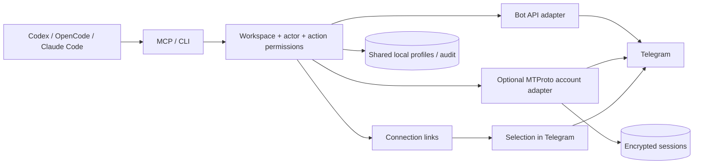

# Аккаунты, подключение ботов и управление Telegram

Принятое направление: Teleprompt поддерживает два способа подключения ботов к группам и каналам — ссылку с выбором чата в Telegram и авторизованный пользовательский аккаунт через MTProto. Несколько аккаунтов, ботов и чатов имеют отдельные профили, описания и workspace-политики.

Это архитектура следующего этапа. В 0.2 реализованы Bot API, бот-профили, адресаты и workspace-политики. Пользовательская авторизация, создание ботов/чатов и расширенная модерация пока не реализованы. Регистрация бота в локальной базе не добавляет его в Telegram-чат.

## Два режима

**Ссылка.** Runtime формирует `startgroup` или `startchannel` для выбранного бота с явно запрошенными правами. Пользователь выбирает чат и подтверждает действие в Telegram. Затем runtime проверяет Telegram identity, членство и права бота, регистрирует bot+chat и по поручению пользователя назначает workspace-доступ. Генерация ссылки сама ничего не меняет в Telegram и не доказывает успешное подключение. [Telegram deep links](https://core.telegram.org/api/links#groupchannel-bot-links).

**Аккаунт.** Локальный интерактивный мастер авторизует пользователя через QR или код, при необходимости с 2FA. Сессия сохраняется для последующих действий. Она действует до отзыва/истечения; `reauth_required` требует нового входа. `api_id/api_hash` идентифицируют приложение, а права принадлежат аккаунту и проверяются отдельно для каждого чата. Чтение канала не даёт права добавлять ботов или назначать администраторов. [Приложение](https://core.telegram.org/api/obtaining_api_id), [авторизация](https://core.telegram.org/api/auth), [QR](https://core.telegram.org/api/qr-login).

Обычные публикации выполняет выбранный бот. Отправка от имени человека требует отдельной возможности и не входит в этот этап. Наличие пользовательской сессии не переключает автоматически исполнителя после отказа Bot API.

## Возможности

| Операция | Исполнитель и условия |
| --- | --- |
| Добавление бота через ссылку | Пользователь выбирает чат, где может добавить участника/администратора |
| Автоматическое подключение бота | Авторизованный аккаунт с соответствующими правами Telegram |
| Создание канала | Аккаунт; `channels.createChannel`, `broadcast=true` |
| Создание группы | Аккаунт; первый этап использует supergroup: `megagroup=true` |
| Создание managed bot | Аккаунт и заранее выбранный manager bot с включённой функцией управления ботами |
| Изменение публичного профиля бота | Bot token: имя, описание, краткое описание, команды |
| Внутреннее описание назначения/аудитории | Локальный runtime; отдельные поля от публичного профиля Telegram |
| Изменение названия/описания чата | Разрешённый бот или аккаунт с необходимыми Telegram-правами |
| Удаление сообщения, ban/restrict/unban участника | Предпочтительно бот-администратор; аккаунт — при явном выборе исполнителя |
| Назначение/снятие администратора | Отдельное разрешение; Telegram ограничивает права, которые исполнитель может передать |

Источники: [создание чата](https://core.telegram.org/method/channels.createChannel), [приглашение](https://core.telegram.org/method/channels.inviteToChannel), [администраторы](https://core.telegram.org/method/channels.editAdmin), [Bot API](https://core.telegram.org/bots/api).

### Создание ботов

Официальный managed-bot flow использует `bots.checkUsername` и `bots.createBot`. Созданный бот принадлежит пользователю, а указанный manager bot получает возможность управлять им. У менеджера должна быть включена соответствующая функция в BotFather. Обычный bot token её не включает. [Managed bots](https://core.telegram.org/api/bots/managed-bots).

После создания менеджер получает token через `getManagedBotToken`. Runtime проверяет Telegram identity и сохраняет credentials локально, без токена в MCP-ответе или audit. Если создание удалось, а получение credentials нет, сохраняется известный bot ID: восстанавливается подключение существующего бота, новый автоматически не создаётся. [Получение токена](https://core.telegram.org/bots/api#getmanagedbottoken).

Обычные боты остаются совместимыми: создание в BotFather и регистрация предоставленного токена. Автоматизация текстового диалога с BotFather не становится основным API-контрактом. Username, удаление бота и передача владения не входят в универсальное редактирование профиля.

## Общий runtime

CLI, MCP и будущая панель используют общий service layer. MTProto подключается при обращении к аккаунту; запуск MCP и обычная Bot API-работа не инициируют пользовательский вход или чтение всех диалогов. Нет инструмента произвольного MTProto RPC.

Профиль account содержит alias, Telegram user ID, username, название, назначение и состояние авторизации. API credentials и session хранятся отдельно от возвращаемых метаданных. У bot появляются необязательные owner account / manager bot и проверенная manager capability. Наличие токена не доказывает владение ботом аккаунтом.

Chat получает независимую Telegram identity, тип и описание аудитории. Связи с аккаунтами и ботами отдельные; существующие bot+target alias, routing и архив сохраняются. Новая сессия не открывает личные сообщения, контакты и полный каталог диалогов другим workspace. Выбор доступных чатов требует отдельного разрешённого discovery.

Сессии и API secrets зашифрованы в общей локальной базе, ключ вне репозитория. Пароль 2FA и одноразовый код не сохраняются. У account alias один владелец MTProto-соединения, координация между MCP/CLI через runtime и lease. Требуются ограниченные ожидания, освобождение lease и сохранение обновлённой session до возврата успеха. Несколько клиентов не используют одну сессию параллельно с разных IP.

Удаление локального профиля и удалённый logout — разные операции. Истечение/отзыв сессии блокирует account-действия и переводит профиль в reauth_required; Bot API продолжает работать в пределах прежних разрешений.

## Разрешения

У каждой операции два условия: workspace разрешает действие выбранному исполнителю, Telegram разрешает его фактически. Прямое поручение человека определяет содержание; Telegram-сообщения, ссылки и описания не выдают разрешения.

| Новое право | Область |
| --- | --- |
| `moderate` | Конкретный chat, явные сообщения/участники; новые ban/restrict/unban |
| `edit_chat` | Название, описание и настройки конкретного чата |
| `manage_admins` | Назначение и права администраторов конкретного чата |
| `connect_bot` | Указанные account + bot + chat и явно перечисленные права |
| `create_chat` | Указанный account, тип создаваемого чата и назначение |
| `create_bot` | Указанные account + manager bot |
| `edit_bot_profile` | Указанный bot, публичные поля/команды |
| `account_discovery` | Выбор доступных чатов указанного аккаунта |
| `manage_accounts` | Локальные профили и авторизация, отдельно от bot registry |

Миграция не превращает существующие all/write/manage в разрешение использовать пользовательские аккаунты, создавать ресурсы или банить участников. Новые возможности по умолчанию выключены. Разрешённые в 0.2 delete/pin сохраняют поведение без расширения на управление участниками. Публикационные правила bot+chat продолжают работать.

Создание ещё не существующего чата разрешается по account и виду действия. Успешное создание регистрирует ресурс, но не выдаёт доступ другим проектам. Политики редактируются/удаляются с revision; привязки по Git identity или точной директории сохраняются.

## Исходы и audit

Внешняя запись получает стабильный request_id, workspace, исполнителя, адресат/создаваемый ресурс, параметры и fingerprint. Секреты не выводятся. Повтор успеха возвращает результат; pending/unknown не вызывает автоматический retry. MTProto-библиотека должна иметь явно настроенные повторы: скрытая повторная запись не заменяет audit.

Составные операции имеют отдельные шаги: создание чата, назначение username, подключение бота, выдача прав. Если следующий шаг не удался, возвращаются известный chat/bot ID и незавершённый шаг. Runtime не создаёт второй ресурс и не удаляет первый автоматически. Получение и локальное сохранение credentials имеют отдельный checkpoint без секрета в общем результате.

Модерация адресует конкретного участника/сообщение. Массовые действия и автономные правила требуют отдельного поручения с областью, условиями и сроком. Из содержимого сообщений нельзя выводить разрешение на ban.

## Реализация и приёмка

1. Ссылки подключения и проверка добавленного бота: URL/права, группа/канал, отсутствие Telegram-записи при генерации ссылки.
2. Account profiles и локальный QR/код/2FA-вход: encrypted storage, перезапуск, отзыв/повторный вход, lease, отсутствие secrets в ответах; Bot API работает без аккаунта.
3. Account permissions и автоматическое подключение бота: readonly/deny, отзыв в активной сессии, Telegram-права, отсутствие скрытого повышения полномочий.
4. Создание группы/канала и managed bot: manager capability, username, частичные исходы, replay/unknown, сохранение созданных ID без дублей.
5. Публичные настройки ботов и модерация: точный исполнитель/адресат, предел передаваемых админ-прав, ban/restrict/unban и audit.
6. Приёмка из Codex, OpenCode и Claude Code: общая сохранённая сессия, разные workspace и permissions, один локальный runtime.

Живые проверки проводятся в выбранных тестовых чатах над тестовыми участниками/сообщениями. Этап готов после работающего сценария и отрицательных проверок. Документирование API и поддельный transport не заменяют живую приёмку.
