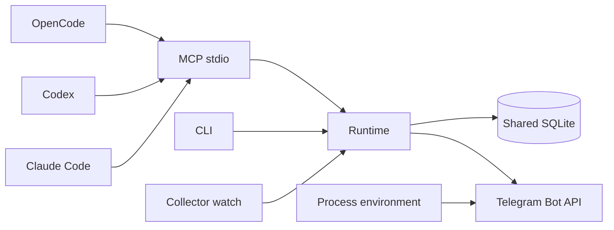

# Архитектура Teleprompt

Teleprompt предоставляет установленную у пользователя возможность управлять Telegram из разных агентских клиентов. Модель, роль и стиль общения не определяют профили Telegram; активный workspace определяет разрешения. Версия 0.2 использует Bot API. Следующий этап включает ссылки подключения и optional MTProto account adapter для добавления ботов, создания ресурсов и управления; архитектура и границы реализации описаны в [ACCOUNT_CONTROL.md](ACCOUNT_CONTROL.md). Облачному чату без доступа к локальному MCP потребуется защищённый gateway.

MCP-сессии запускают свои процессы и разделяют SQLite вне репозитория. Сбор выделен в отдельный watch, чтобы закрытие агентского чата не прекращало наблюдение. На старте MCP нет сетевых вызовов и polling. CLI и MCP используют один Runtime/Store.

## Профили

Bot: alias, Telegram ID, username, отображаемое название, описание, local credential либо env-reference. Target: alias, bot_alias, числовой chat_id, username, название, описание аудитории, writable. Один chat_id может обслуживаться разными ботами через разные alias. Профили не подменяются; rotation проверяет bot identity. Адресат задаётся явно, темы — через thread_id. Bot secrets зашифрованы в SQLite, ключ находится вне репозитория рядом с базой. [Правила контекста и доступа](ACCESS_POLICIES.md).

## Сбор и архив

SQLite: WAL, busy timeout, короткие транзакции. Lease на bot_alias с owner и сроком 90 секунд координирует только процессы одной базы. Сетевые таймауты ограничены. Протухший владелец не может зафиксировать offset. Чужие программы, потребляющие обновления того же бота, не координируются.

Разрешённые обновления, сообщения и следующий offset записываются атомарно. Ключ update: bot_alias + update_id; message: bot_alias + chat_id + message_id. Повторы дедуплицируются. Известная правка защищена от поздней исходной версии. Raw message сохраняет медиа-метаданные. Чужие чаты пропускаются, offset продвигается по всему batch.

Webhook conflict останавливает polling без перенастройки бота. Watch поддерживает несколько ботов, backoff, retry_after и остановку. First_sync, last_sync, next_offset, last_error описывают сборщик, не доказывая полноту истории.

## Исход записи

Перед сетью резервируются request_id и fingerprint бота, адресата, метода и параметров. Сетевой вызов не удерживает database lock.

| Состояние | Значение |
|---|---|
| pending | Начато; процесс работает или прервался до записи результата |
| succeeded | Получен и сохранён успешный ответ |
| failed | Явный отказ Telegram либо ошибка credentials до запроса |
| unknown | После ошибки исход не установлен |

Успех сохраняет результат и обновляет архив. Повтор с тем же ID возвращает результат, другой fingerprint отклоняется. Для unresolved исходов повторная отправка блокируется. Ручная отправка нового ID может создать дубль — сначала нужен осмотр Telegram. Удаление помечает локальную запись, сохраняя архив; внешние удаления не отслеживаются. В канале видимым автором может быть канал, хотя действие выполняется ботом.

## Инструменты и доверие

MCP имеет отдельные инструменты без произвольного Telegram-метода. Credentials/metadata/policy management требуют manage либо разрешённого первоначального setup. Runtime проверяет scope перед данными, публикацией, audit и operation replay. Annotations различают чтение и изменения. Skill описывает адресацию, прямое поручение человека и неизвестные исходы. Сервер не доказывает получение поручения человеком; локальные файлы и административный CLI принадлежат доверенному владельцу.

## Статистика

Расчёты используют текущие версии наблюдавшихся сообщений: количество, известные bot-авторы, наблюдаемые sender_id, дневная UTC-активность, 20 активных авторов. Правки не увеличивают число сообщений. Счётчик участников онлайн — отдельный текущий показатель. Ответ содержит coverage и статус сборщика. Отсутствие записей означает отсутствие наблюдений, а не отсутствие активности группы. Просмотры канала, внешние удаления и полная история участников недоступны.
